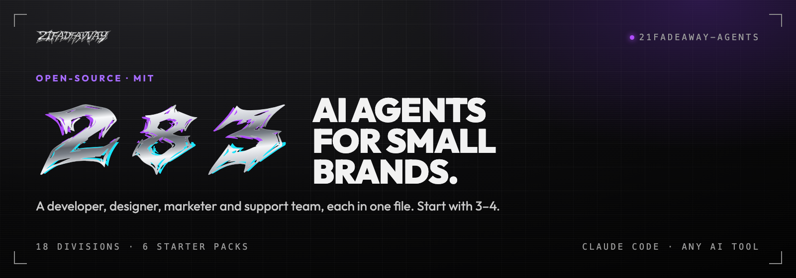

<p align="center"></p>

# 21FADEAWAY Agents

**283 AI agents for small brands, solo founders and creators.** A developer, a designer, a marketer and a support team, each written as one file you can drop into Claude Code or any AI tool.

Built by [21FADEAWAY](https://21fadeaway.ro), a streetwear brand from Timișoara that runs on AI agents.

> Don't install 283. Start with 3–4.

## What makes this edition different

- **21 edition of every agent.** Each one ends with a *21FADEAWAY Edition* section: small-team rules (ask for the brief, ship the smallest version, mark assumptions, end with next steps) and ready prompts to try.
- **Starter packs.** Four agents picked for your kind of business, installed with one command.
- **One installer.** `./install.sh` copies a pack, a division or one agent into your project.

## Quick start

```bash
git clone https://github.com/21fadeaway/21fadeaway-agents.git
cd your-project
../21fadeaway-agents/install.sh streetwear-brand .
```

Start a new Claude Code session and ask by name:

```
Use 21 Brand Guardian to review our homepage and list the top 5 fixes.
```

**Other tools** (Cursor, Copilot, ChatGPT, Gemini…): open any agent file and paste it as the system prompt or custom instructions.

**Read before you install.** Every agent is a prompt. Open the file and check what it tells the AI to do.

## Starter packs

| Pack | For | Agents |
| --- | --- | --- |
| [Streetwear brand](packs/streetwear-brand.md) | For a clothing or merch brand selling online and growing on Instagram. | 21 Brand Guardian, 21 Instagram Curator, 21 Frontend Developer, 21 Customer Service |
| [Online shop](packs/online-shop.md) | For any small e-commerce store that needs traffic and happy customers. | 21 Frontend Developer, 21 SEO Specialist, 21 Paid Social Strategist, 21 Customer Service |
| [Content creator](packs/content-creator.md) | For creators who post daily and want to grow faster. | 21 Content Creator, 21 TikTok Strategist, 21 Instagram Curator, 21 Carousel Growth Engine |
| [Solo developer](packs/solo-developer.md) | For one person building and shipping an app or SaaS. | 21 Senior Developer, 21 Code Reviewer, 21 Reality Checker, 21 AI-Generated Code Security Auditor |
| [Local business](packs/local-business.md) | For a cafe, studio, salon or shop with a physical location. | 21 Social Media Strategist, 21 SEO Specialist, 21 Customer Service, 21 Bookkeeper & Controller |
| [Freelancer](packs/freelancer.md) | For designers, developers and creatives who sell their own services. | 21 Outbound Strategist, 21 Proposal Strategist, 21 Project Shepherd, 21 UI Designer |

## All 18 divisions

| Division | Agents | Examples |
| --- | --- | --- |
| [Engineering](agents/engineering) | 66 | 21 AI Data Remediation Engineer, 21 AI Engineer, 21 API Platform Engineer |
| [Specialized](agents/specialized) | 59 | 21 Accounts Payable Agent, 21 Agentic Identity & Trust Architect, 21 Agents Orchestrator |
| [Marketing](agents/marketing) | 37 | 21 AEO Foundations Architect, 21 Agentic Search Optimizer, 21 AI Citation Strategist |
| [Game development](agents/game-development) | 21 | 21 Blender Add-on Engineer, 21 Economy Designer, 21 Game Audio Engineer |
| [Maps & GIS](agents/gis) | 13 | 21 3D & Scene Developer, 21 BIM/GIS Specialist, 21 Cartography Designer |
| [Security](agents/security) | 12 | 21 AI-Generated Code Security Auditor, 21 Application Security Engineer, 21 Blockchain Security Auditor |
| [Design](agents/design) | 10 | 21 Brand Guardian, 21 Image Prompt Engineer, 21 Inclusive Visuals Specialist |
| [Sales](agents/sales) | 9 | 21 Account Strategist, 21 Deal Strategist, 21 Discovery Coach |
| [Testing](agents/testing) | 9 | 21 Accessibility Auditor, 21 API Tester, 21 Evidence Collector |
| [Paid media](agents/paid-media) | 7 | 21 Ad Creative Strategist, 21 Paid Media Auditor, 21 Paid Social Strategist |
| [Project management](agents/project-management) | 7 | 21 Experiment Tracker, 21 Jira Workflow Steward, 21 Meeting Notes Specialist |
| [Academic](agents/academic) | 6 | 21 Anthropologist, 21 Geographer, 21 Historian |
| [Product](agents/product) | 6 | 21 Behavioral Nudge Engine, 21 DX Engineer, 21 Feedback Synthesizer |
| [Spatial computing](agents/spatial-computing) | 6 | 21 macOS Spatial/Metal Engineer, 21 Terminal Integration Specialist, 21 visionOS Spatial Engineer |
| [Support](agents/support) | 6 | 21 Analytics Reporter, 21 Executive Summary Generator, 21 Finance Tracker |
| [Finance](agents/finance) | 5 | 21 Bookkeeper & Controller, 21 Financial Analyst, 21 FP&A Analyst |
| [Healthcare](agents/healthcare) | 3 | 21 Clinical Evidence Agent, 21 Healthcare Innovation Strategist, 21 Sovereign Health Systems Agent |
| [Research](agents/research) | 1 | 21 Research Synthesist |

Full list with descriptions: [agents.json](agents.json).

## Commands

```bash
./install.sh list               # packs and divisions
./install.sh <pack> [folder]    # e.g. ./install.sh online-shop ~/my-shop
./install.sh <division> [folder]  # e.g. ./install.sh design
./install.sh all [folder]       # all 283 (not recommended)
```

## Credits and license

The original agents come from [The Agency](https://github.com/msitarzewski/agency-agents) by msitarzewski and contributors, under the MIT license. 21FADEAWAY renamed them, added the 21FADEAWAY Edition sections, the starter packs and the installer. Both copyright notices are in [LICENSE](LICENSE).

21FADEAWAY is not affiliated with Anthropic. "Claude" and "Claude Code" are trademarks of Anthropic.

---

<p align="center"><b>21FADEAWAY</b> · <a href="https://21fadeaway.ro">21fadeaway.ro</a> · <a href="https://21fadeaway.ro/ai-lab.html">AI Lab</a></p>
